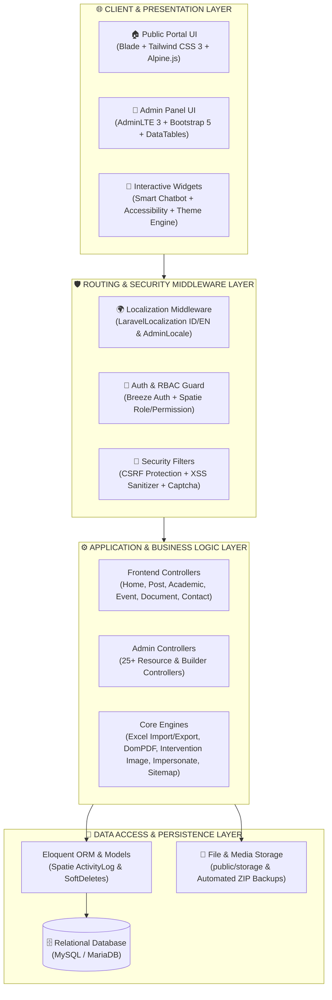
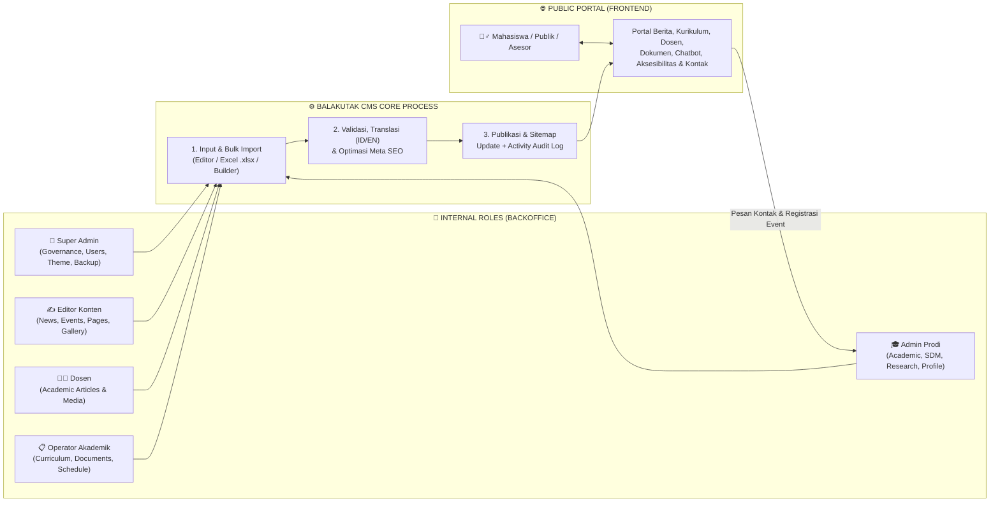

<div align="center">


# 🦑 BalaKutaK CMS — Official System Documentation
### *Enterprise & Academic Open-Source Content Management System (v2.0.1 Stable)*

[](https://opensource.org/licenses/MIT)
[](https://laravel.com)
[](https://php.net)
[](#5-keunggulan-aplikasi-competitive-advantages)
[](#6-panduan-penggunaan-detail-semua-role-user-step-by-step)

<br />

### 📥 Unduh Buku Panduan & Dokumentasi Resmi (PDF)
Klik tombol di bawah ini untuk mengunduh dokumen spesifikasi teknis, arsitektur, proses bisnis, regulasi, dan panduan penggunaan *step-by-step* lengkap dalam format **PDF Siap Cetak**:

[-BalaKutaK_CMS_v2.0.1-DC2626?style=for-the-badge&logo=adobeacrobatreader&logoColor=white)](docs/Panduan-Lengkap-BalaKutaK-CMS.pdf)
[](resources/views/admin/guide/index.blade.php)

</div>

---

## 📑 Daftar Isi (Menu Dokumentasi)

1. [**BAB 1 — Deskripsi Aplikasi & Filosofi**](#-1-deskripsi-aplikasi--filosofi-balakutak-cms)
   - [1.1 Mengenal Lebih Dekat BalaKutaK CMS](#11-mengenal-lebih-dekat-balakutak-cms)
   - [1.2 Filosofi Nama "BalaKutaK"](#12-filosofi-nama-balakutak)
   - [1.3 Solusi Multi-Sektor (Target Pengguna)](#13-solusi-multi-sektor-target-pengguna)
   - [1.4 Ruang Lingkup Ekosistem Modul](#14-ruang-lingkup-ekosistem-modul)
2. [**BAB 2 — Arsitektur Aplikasi & Stack Teknologi**](#️-2-arsitektur-aplikasi--stack-teknologi)
   - [2.1 Diagram Arsitektur Sistem Berlapis](#21-diagram-arsitektur-sistem-berlapis-multi-tier-mvc)
   - [2.2 Penjabaran Komponen Lapisan Arsitektur](#22-penjabaran-komponen-lapisan-arsitektur)
   - [2.3 Struktur Direktori Proyek](#23-struktur-direktori-proyek)
   - [2.4 Spesifikasi Stack Teknologi Lengkap](#24-spesifikasi-stack-teknologi-lengkap)
3. [**BAB 3 — Proses Bisnis Aplikasi (Business Workflows)**](#-3-proses-bisnis-aplikasi-business-workflows)
   - [3.1 Diagram Alur Proses Bisnis Terintegrasi](#31-diagram-alur-proses-bisnis-terintegrasi)
   - [3.2 Alur Bisnis Publikasi & Editorial Konten](#32-alur-bisnis-publikasi--editorial-konten)
   - [3.3 Alur Bisnis Pengelolaan Akademik, Tridharma & Bulk Excel](#33-alur-bisnis-pengelolaan-akademik-tridharma--bulk-excel)
   - [3.4 Alur Bisnis Interaksi Publik, Chatbot & Aksesibilitas](#34-alur-bisnis-interaksi-publik-chatbot--aksesibilitas)
   - [3.5 Alur Bisnis Tata Kelola Sistem & Pencadangan](#35-alur-bisnis-tata-kelola-sistem--pencadangan)
4. [**BAB 4 — Regulasi, Kebijakan & Standar Aplikasi**](#️-4-regulasi-kebijakan--standar-aplikasi)
   - [4.1 Regulasi Hak Akses & Otorisasi (Matriks RBAC)](#41-regulasi-hak-akses--otorisasi-matriks-rbac)
   - [4.2 Regulasi Keamanan Siber & Pelindungan Data](#42-regulasi-keamanan-siber--pelindungan-data)
   - [4.3 Regulasi Standar Konten Dwibahasa & Akademik](#43-regulasi-standar-konten-dwibahasa--akademik)
   - [4.4 Regulasi Inklusivitas, Aksesibilitas & Backup](#44-regulasi-inklusivitas-aksesibilitas--backup)
5. [**BAB 5 — Keunggulan Aplikasi (Competitive Advantages)**](#-5-keunggulan-aplikasi-competitive-advantages)
6. [**BAB 6 — Panduan Penggunaan Detail Semua Role User (Step-by-Step)**](#-6-panduan-penggunaan-detail-semua-role-user-step-by-step)
   - [Tabel Akun Default (Seeder Credentials)](#tabel-akun-default-seeder-credentials)
   - [6.1 Panduan Role 1: Super Admin (`superadmin@prodi.ac.id`)](#61-panduan-role-1-super-admin-superadminprodiacid)
   - [6.2 Panduan Role 2: Admin Prodi (`admin@prodi.ac.id`)](#62-panduan-role-2-admin-prodi-adminprodiacid)
   - [6.3 Panduan Role 3: Editor Konten (`editor@prodi.ac.id`)](#63-panduan-role-3-editor-konten-editorprodiacid)
   - [6.4 Panduan Role 4: Dosen (`dosen@prodi.ac.id`)](#64-panduan-role-4-dosen-dosenprodiacid)
   - [6.5 Panduan Role 5: Operator Akademik (`operator@prodi.ac.id`)](#65-panduan-role-5-operator-akademik-operatorprodiacid)
   - [6.6 Panduan Role 6: Pengunjung Publik / Mahasiswa (Frontend User)](#66-panduan-role-6-pengunjung-publik--mahasiswa-frontend-user)
7. [**BAB 7 — Galeri Pratinjau & Screenshot Aplikasi Lengkap**](#-7-galeri-pratinjau--screenshot-aplikasi-lengkap)
8. [**BAB 8 — Panduan Instalasi Cepat (Quick Start)**](#-8-panduan-instalasi-cepat-quick-start)
9. [**BAB 9 — Lisensi & Unduhan Dokumentasi PDF**](#-9-lisensi--unduhan-dokumentasi-pdf)

---

## 🌐 1. Deskripsi Aplikasi & Filosofi BalaKutaK CMS

### 1.1 Mengenal Lebih Dekat BalaKutaK CMS
**BalaKutaK CMS** adalah sistem manajemen konten (*Content Management System*) berbasis *open-source* kelas enterprise yang dirancang khusus untuk menyederhanakan proses pembuatan, kustomisasi visual, dan tata kelola portal web modern tanpa mengorbankan kecepatan maupun keamanan. Mengusung filosofi **"Ringan, Cerdas & Adaptif"**, platform ini menjembatani pengguna non-teknis (staf administrasi, redaksi, dosen) hingga pengembang profesional dalam menghadirkan identitas digital yang berkelas.

### 1.2 Filosofi Nama "BalaKutaK"
> **🦑 Filosofi Nama:**  
> **BalaKutaK** (Sotong/Cumi-cumi dalam khazanah bahasa Nusantara/Sunda) dipilih sebagai simbol **fleksibilitas tinggi, kecerdasan navigasi, dan kemampuan beradaptasi secara instan** di berbagai lingkungan—sebagaimana sotong yang mampu mengubah warna serta tekstur kulitnya (kamuflase kromatofora) dalam hitungan detik. Filosofi ini diwujudkan melalui fitur **Dynamic Theme Engine** dan arsitektur modular BalaKutaK CMS yang lincah namun kokoh.

### 1.3 Solusi Multi-Sektor (Target Pengguna)
Meskipun dilengkapi dengan **Academic & Accreditation Suite** yang sangat komprehensif untuk Perguruan Tinggi, desain modular BalaKutaK CMS menjadikannya solusi ideal bagi berbagai sektor:
* 🎓 **Perguruan Tinggi, Fakultas & Program Studi**: Mengelola profil prodi, direktori dosen ber-NIDN, struktur kurikulum per semester, repositori riset & pengabdian masyarakat, kalender akademik, layanan mahasiswa, hingga pratinjau sertifikat akreditasi interaktif.
* 🏫 **Sekolah & Lembaga Pendidikan**: Mempermudah pengelolaan profil sekolah, pengumuman kelulusan/PPDB, portal berita siswa, dan galeri kegiatan ekstrakurikuler.
* 🏛️ **Instansi Pemerintahan, Organisasi & LSM**: Platform transparan untuk mempublikasikan laporan kinerja, dokumen regulasi publik, agenda kegiatan, dan layanan pengaduan/kontak masyarakat.
* 🏢 **Perusahaan & Komunitas Digital**: Wadah kolaborasi modern dengan dukungan *Visual Page Builder*, manajemen mitra kerjasama, sponsor, testimoni, serta blog dwibahasa.

### 1.4 Ruang Lingkup Ekosistem Modul
| Domain Ekosistem | Cakupan Modul & Fitur Inti |
| :--- | :--- |
| **🎨 Immersive UI & Theme Engine** | 20+ Palet Tema Premium (*Aurora Glass*, *Oxford Luxury*, *Stanford Grow*, *NavyBlue*, *GreenGold*, dll), *Smart Dark Mode*, animasi *AOS*, dan tipografi modern. |
| **📰 Editorial & Publikasi Konten** | Berita & Artikel Bilingual (ID/EN), Kategori, Tag, Pengumuman Prioritas (*Marquee*), Agenda & Event (*Countdown* & URL Pendaftaran), Halaman Statis, dan FAQ. |
| **🎓 Academic & Tridharma Suite** | Direktori SDM/Dosen, Struktur Kurikulum Semester, Kalender Akademik, Layanan Akademik, Penelitian & Pengabdian Masyarakat (seluruhnya mendukung *Export/Import Excel*), serta Pusat Dokumen & Sertifikat Akreditasi. |
| **🛠️ Site & Visual Builder** | *Drag-and-Drop Menu Builder* (Header & Footer bertingkat), *Visual Page Builder* (penyusunan blok tanpa koding), *Media Library* terpusat, Galeri Album, Slider, Infografis, Mitra, dan Sponsor. |
| **🤖 Smart Assist & Accessibility** | Widget *Smart Chatbot* interaktif dan *Accessibility Suite* ramah disabilitas (*Text-to-Speech*, Kontras Tinggi, Grayscale, Perbesar Font) yang adaptif terhadap warna tema. |
| **🛡️ System Security & Governance** | Kontrol Akses Berbasis Role (Spatie RBAC), *User Impersonation*, Pencadangan Otomatis/Manual (`.zip`), Manajemen SEO & Sitemap XML otomatis, serta Audit Log Aktivitas. |

---

## 🏗️ 2. Arsitektur Aplikasi & Stack Teknologi

### 2.1 Diagram Arsitektur Sistem Berlapis (Multi-Tier MVC)
Secara teknis, BalaKutaK CMS mengadopsi arsitektur **Layered Model-View-Controller (MVC)** di atas fondasi **Laravel 11.x (PHP 8.2+)**. Pemisahan lapisan yang tegas menjamin skalabilitas, kemudahan pemeliharaan (*maintainability*), serta keamanan data berlapis.



### 2.2 Penjabaran Komponen Lapisan Arsitektur
1. **Presentation Layer (Antarmuka Pengguna)**:
   * **Frontend Portal**: Dirender secara dinamis menggunakan *Laravel Blade* yang dipadukan dengan *Tailwind CSS 3*, *Alpine.js*, *Swiper.js*, dan *AOS*. Mendukung injeksi variabel CSS dinamis sesuai tema yang dipilih (*Aurora Glass*, *Oxford Luxury*, dll.).
   * **Admin Dashboard**: Dibangun menggunakan *AdminLTE 3* yang ergonomis, dilengkapi *DataTables Server-Side/Client-Side*, *Select2*, *SweetAlert2*, *Toastr*, dan grafik analitik *Chart.js*.
2. **Routing & Security Middleware Layer (Keamanan & Lokalisasi)**:
   * Setiap *request* publik melewati `LaravelLocalization` untuk merutekan bahasa secara transparan (`/id/...` atau `/en/...`).
   * Setiap *request* ke `/admin/*` wajib melewati autentikasi sesi, verifikasi akun, `AdminLocale`, serta pengecekan izin granular (`can:view posts`, `role:Super Admin`, dll.).
3. **Application & Business Logic Layer (Logika Bisnis & Pemrosesan)**:
   * Mengelola validasi transaksi, pemrosesan unggahan media dengan `Intervention Image`, konversi massal lembar kerja `Maatwebsite/Excel`, pencetakan dokumen `DomPDF`, serta simulasi sesi lintas pengguna dengan `Lab404/Impersonate`.
4. **Data Access & Persistence Layer (Penyimpanan & Pencadangan)**:
   * Menggunakan *Eloquent ORM* untuk berinteraksi secara aman (bebas *SQL Injection*) dengan MySQL/MariaDB.
   * Mencatat jejak audit otomatis menggunakan `spatie/laravel-activitylog` dan mengemas cadangan penuh aplikasi + database melalui `spatie/laravel-backup`.

### 2.3 Struktur Direktori Proyek
```text
balakutak/
├── app/
│   ├── Exports/ & Imports/       # Kelas pemrosesan Export & Import Excel (.xlsx)
│   ├── Http/
│   │   ├── Controllers/Admin/    # 25+ Controller manajemen panel administrasi
│   │   ├── Controllers/Frontend/ # Controller penyajian portal publik & akademik
│   │   └── Middleware/           # Middleware lokalisasi & otorisasi
│   └── Models/                   # Model Eloquent (Post, Lecturer, Curriculum, Setting, dll.)
├── config/
│   ├── adminlte.php              # Konfigurasi menu sidebar admin & integrasi permission
│   ├── backup.php                # Konfigurasi sistem backup otomatis & retensi
│   └── permission.php            # Konfigurasi Spatie Role & Permission
├── database/
│   ├── migrations/               # Skema struktur tabel database relasional
│   └── seeders/                  # Seeder identitas, RolePermissionSeeder, UserSeeder, dll.
├── docs/
│   ├── screenshots/              # Dokumentasi tangkapan layar aplikasi lengkap
│   └── Panduan-Lengkap-BalaKutaK-CMS.pdf # Buku Manual & Dokumentasi Resmi (PDF)
├── public/
│   ├── css/themes/               # 20+ Stylesheet tema dinamis (Aurora Glass, Oxford, dll.)
│   └── images/                   # Aset statis, logo resmi, dan pratinjau tema
├── resources/views/
│   ├── admin/                    # View Blade modul administrasi & Panduan Sistem (guide/)
│   ├── auth/                     # View autentikasi & halaman login kustom
│   └── frontend/                 # View portal publik, parsial chatbot & aksesibilitas
└── routes/
    └── web.php                   # Definisi rute Admin (Protected) & Frontend (Localized)
```

### 2.4 Spesifikasi Stack Teknologi Lengkap
| Kategori | Teknologi / Library | Peran & Fungsi Utama |
| :--- | :--- | :--- |
| **Backend Core** | **Laravel 11.x** (PHP 8.2+) | Kerangka kerja utama aplikasi, manajemen rute, *queue*, dan keamanan. |
| **Database** | **MySQL / MariaDB / SQLite** | Penyimpanan data relasional transaksional berkinerja tinggi. |
| **RBAC & Security** | **Spatie Laravel Permission 6.24** | Manajemen Role & Permission berlapis untuk 5 role internal. |
| **Impersonation** | **Lab404 Laravel Impersonate 1.7** | Fitur *one-click login as user* khusus Super Admin. |
| **Multilingual** | **Mcamara Laravel Localization 2.3** | Manajemen lokalisasi URL dan konten dwibahasa (ID/EN). |
| **Excel Engine** | **Maatwebsite Laravel Excel 3.1** | Ekspor dan impor data massal (`.xlsx`) beserta unduhan template. |
| **PDF & Image** | **DomPDF 3.1 & Intervention Image 3.11** | Generator dokumen PDF dinamis dan pemrosesan gambar unggahan. |
| **Backup & SEO** | **Spatie Backup 9.3 & Sitemap 7.3** | Pencadangan otomatis ke `.zip` dan generator `sitemap.xml` dinamis. |
| **Audit Trail** | **Spatie Activitylog 4.11** | Pencatatan riwayat perubahan data pengguna di dashboard. |
| **Frontend UI** | **Tailwind CSS 3, Bootstrap 5, Alpine.js** | Antarmuka modern, responsif, animasi *AOS*, dan slider *Swiper.js*. |
| **Admin UI** | **AdminLTE 3.15, DataTables, Chart.js** | Panel kontrol responsif dengan tabel interaktif & visualisasi statistik. |

---

## 🔄 3. Proses Bisnis Aplikasi (Business Workflows)

### 3.1 Diagram Alur Proses Bisnis Terintegrasi
Proses bisnis dalam BalaKutaK CMS menghubungkan lima peran internal pengelola dengan pengunjung publik dalam satu siklus informasi yang terstruktur dan terverifikasi:



### 3.2 Alur Bisnis Publikasi & Editorial Konten
1. **Penyusunan Konten (Drafting)**: *Dosen* atau *Editor Konten* menulis berita/artikel melalui *Rich Text Editor* dalam Bahasa Indonesia dan Bahasa Inggris, mengunggah ilustrasi ke *Media Library*, serta memilih Kategori dan Tag.
2. **Kurasi & Optimasi SEO**: *Editor Konten* atau *Admin Prodi* meninjau draft, melengkapi *SEO Meta Title & Description*, lalu mempublikasikan konten (*Published*).
3. **Penayangan & Indeksasi**: Sistem menayangkan artikel secara *real-time* di beranda dan direktori berita sesuai bahasa aktif pengunjung, sekaligus memperbarui peta situs `/sitemap.xml`.

### 3.3 Alur Bisnis Pengelolaan Akademik, Tridharma & Bulk Excel
1. **Manajemen Master Akademik**: *Admin Prodi* dan *Operator Akademik* mengelola profil Dosen/SDM, struktur Kurikulum per semester, Kalender Akademik, Layanan Akademik, serta data Penelitian & Pengabdian Masyarakat.
2. **Akselerasi Data via Excel (`.xlsx`)**:
   * Pengguna mengunduh **Template Excel Resmi** langsung dari modul terkait.
   * Data ratusan mata kuliah, dosen, atau judul riset diisi secara kolektif di Excel.
   * File diunggah kembali melalui fitur **Import Excel**; sistem melakukan *upsert* (pembaruan data lama & penambahan data baru) secara otomatis.
   * Data juga dapat diekspor kapan saja melalui tombol **Export Excel** untuk kebutuhan pelaporan akreditasi.
3. **Publikasi Dokumen & Sertifikat Akreditasi**: *Operator Akademik* mengunggah dokumen resmi (SK, SOP, Panduan), sementara *Admin Prodi* mengunggah Sertifikat Akreditasi yang dapat dilihat langsung melalui *Interactive Document Viewer* oleh asesor maupun masyarakat.

### 3.4 Alur Bisnis Interaksi Publik, Chatbot & Aksesibilitas
1. **Eksplorasi & Inklusivitas**: Pengunjung mengakses portal, memilih bahasa (`ID`/`EN`), mode tampilan (Terang/Gelap), atau mengaktifkan fitur ramah disabilitas (*Text-to-Speech*, Kontras Tinggi, Perbesar Huruf).
2. **Layanan Mandiri via Smart Chatbot**: Pengunjung dapat menanyakan informasi akademik, kurikulum, profil dosen, maupun layanan mahasiswa melalui widget **Chatbot Pintar** yang beroperasi 24/7.
3. **Komunikasi & Partisipasi**: Pengunjung mendaftar pada kegiatan melalui tombol registrasi di modul **Agenda & Event**, atau mengirimkan pesan melalui **Formulir Kontak** (terlindungi Captcha) yang langsung masuk ke kotak masuk *Admin Prodi* untuk dibalas secara resmi.

### 3.5 Alur Bisnis Tata Kelola Sistem & Pencadangan
1. **Kustomisasi Tampilan & Navigasi**: *Super Admin* / *Admin Prodi* mengatur palet warna website di **Pengaturan Tema**, menyusun struktur menu di **Menu Builder**, dan membangun *landing page* di **Page Builder**.
2. **Audit & Disaster Recovery**: Seluruh aksi terekam pada **Log Aktivitas**. *Super Admin* menjadwalkan pencadangan otomatis (Harian/Mingguan/Bulanan) atau menekan tombol **Buat Backup** untuk mengunduh salinan utuh database dan file (`.zip`).

---

## ⚖️ 4. Regulasi, Kebijakan & Standar Aplikasi

Untuk menjaga integritas data, keamanan siber, dan kepatuhan tata kelola institusi, BalaKutaK CMS memberlakukan regulasi sistem sebagai berikut:

### 4.1 Regulasi Hak Akses & Otorisasi (Matriks RBAC)
Sistem menerapkan kebijakan **Role-Based Access Control (RBAC)** berbasis prinsip *Least Privilege*. Pengguna hanya dapat melihat dan mengakses menu yang diizinkan untuk perannya:

| Modul / Hak Akses Sistem | 👑 Super Admin | 🎓 Admin Prodi | ✍️ Editor Konten | 👨‍🏫 Dosen | 📋 Operator Akademik | 🌐 Publik |
| :--- | :---: | :---: | :---: | :---: | :---: | :---: |
| **Dashboard & Statistik** | ✅ Full | ✅ Full | ✅ View | ✅ View | ✅ View | ❌ |
| **Berita & Artikel (Posts)** | ✅ CRUD + Publish | ✅ CRUD + Publish | ✅ Create/Edit/Publish | ✅ Create/Edit | ❌ | 👀 Read |
| **Kategori & Tag Artikel** | ✅ CRUD | ✅ Create/Edit | 👀 View | ❌ | ❌ | 👀 Read |
| **Pengumuman Resmi** | ✅ CRUD | ✅ CRUD | ✅ Create/Edit | ❌ | ✅ Create/Edit | 👀 Read |
| **Agenda & Event** | ✅ CRUD | ✅ CRUD | ✅ Create/Edit | ❌ | ✅ Create/Edit | 👀 Read & Daftar |
| **Halaman Statis & FAQs** | ✅ CRUD | ✅ Create/Edit | ✅ Create/Edit | ❌ | ❌ | 👀 Read |
| **Galeri Foto & Video** | ✅ CRUD | ✅ CRUD | ✅ Create/Edit | ❌ | ❌ | 👀 View |
| **Media Library (File Manager)** | ✅ Upload/Delete | ✅ Upload/Delete | ✅ Upload/View | ✅ Upload/View | ✅ Upload/View | ❌ |
| **SDM / Dosen (Import/Export)** | ✅ CRUD | ✅ CRUD | ❌ | ❌ | ❌ | 👀 View Profil |
| **Kurikulum (Import/Export)** | ✅ CRUD | ✅ CRUD | ❌ | ❌ | ✅ Create/Edit | 👀 View |
| **Kalender, Layanan & Riset** | ✅ CRUD | ✅ CRUD | ❌ | ❌ | ✅ Create/Edit | 👀 View |
| **Pusat Dokumen Resmi** | ✅ CRUD | ✅ CRUD | ❌ | ❌ | ✅ Create/Edit | 📥 Download |
| **Slider, Mitra & Testimoni** | ✅ CRUD | ✅ CRUD / Approve | ❌ | ❌ | ❌ | 👀 View |
| **Menu Builder & Page Builder** | ✅ CRUD | ✅ Create/Edit | ❌ | ❌ | ❌ | ❌ |
| **Pesan Kontak Pengunjung** | ✅ Read/Reply/Del | ✅ Read/Reply | ❌ | ❌ | ❌ | ✉️ Send Form |
| **Pengaturan Situs, Tema & SEO** | ✅ Full Access | ✅ Full Access | ❌ | ❌ | ❌ | ❌ |
| **Kelola User & Role Assignment** | 🔒 **Exclusive** | ❌ | ❌ | ❌ | ❌ | ❌ |
| **Impersonate (Simulasi User)** | 🔒 **Exclusive** | ❌ | ❌ | ❌ | ❌ | ❌ |
| **Backup Sistem (`.zip` & Jadwal)** | 🔒 **Exclusive** | ❌ | ❌ | ❌ | ❌ | ❌ |

### 4.2 Regulasi Keamanan Siber & Pelindungan Data
* **Kebijakan Kredensial & Autentikasi**: Seluruh kata sandi dienkripsi dengan *Bcrypt hashing*. Pada implementasi produksi (*production*), seluruh akun default wajib segera mengganti kata sandi bawaan.
* **Proteksi Injeksi & Pemalsuan Permintaan**: Seluruh formulir dilindungi oleh **CSRF Token** dan pembersihan input terhadap serangan **XSS (Cross-Site Scripting)** maupun **SQL Injection**.
* **Proteksi Anti-Spam & Bot**: Formulir publik (Kontak) diwajibkan melewati validasi **Dynamic Captcha** sebelum pesan dapat disimpan ke database.
* **Validasi Ketat File Unggahan**: Sistem membatasi jenis MIME dan ukuran file unggahan pada *Media Library*, *Dokumen*, dan *Import Excel* guna mencegah penyusupan skrip berbahaya.
* **Kewajiban Audit Trail**: Setiap tindakan pembuatan, pembaruan, dan penghapusan rekaman data tercatat secara otomatis pada log aktivitas beserta identitas pelaku dan waktu kejadian.

### 4.3 Regulasi Standar Konten Dwibahasa & Akademik
* **Standar Dwibahasa (ID/EN)**: Konten publikasi utama dilengkapi dukungan atribut Bahasa Indonesia dan Bahasa Inggris guna memenuhi standar internasionalisasi institusi pendidikan tinggi.
* **Standar Validitas Data Akademik**: Data kurikulum wajib mencantumkan Kode Mata Kuliah, Bobot SKS, dan Semester yang sah; data dosen wajib mencantumkan identitas akademik (NIDN/Kepakaran) sesuai pangkalan data pendidikan tinggi.

### 4.4 Regulasi Inklusivitas, Aksesibilitas & Backup
* **Kepatuhan Aksesibilitas Disabilitas**: Portal publik wajib menyediakan widget aksesibilitas aktif (*Text-to-Speech*, *High Contrast*, *Grayscale*, *Font Scaling*, *Readable Font*) tanpa menghalangi elemen navigasi utama.
* **Regulasi Pencadangan Data (Disaster Recovery Plan)**: *Super Admin* wajib menjadwalkan pencadangan otomatis (*Automated Backup*) minimal **1 kali setiap minggu** dan mengunduh arsip `.zip` ke penyimpanan terpisah (*off-site storage*).

---

## 🌟 5. Keunggulan Aplikasi (Competitive Advantages)

Mengapa **BalaKutaK CMS** menjadi pilihan unggul dibandingkan CMS konvensional?

| No | Keunggulan Utama | Penjelasan & Nilai Tambah Nyata |
| :---: | :--- | :--- |
| **1** | **🎨 Dynamic Multi-Theme Engine (20+ Tema Premium)** | Ganti tampilan website secara instan tanpa menyentuh kode! Dilengkapi lebih dari 20 tema kurasi seperti **Aurora Glass** (efek *glassmorphism* modern), **Oxford Luxury** (*NavyGold, RedGold, GreenGold, BlackGold*), **Stanford Grow**, hingga **Royal Purple**. |
| **2** | **🎓 All-in-One Academic & Accreditation Suite** | Dirancang selaras dengan kebutuhan instrumen akreditasi kampus: modul SDM Dosen, Kurikulum, Kalender Akademik, Layanan Akademik, Penelitian & Pengabdian, hingga **Interactive Accreditation Certificate Viewer** (PDF & Gambar). |
| **3** | **🖱️ Visual Drag & Drop Menu & Page Builder** | Kelola struktur navigasi bertingkat (Header & Footer) serta bangun halaman *Landing Page* kustom secara visual blok demi blok tanpa keahlian pemrograman (*No-Code Builder*). |
| **4** | **🤖 Smart Chatbot & Inclusive Accessibility Suite** | Dilengkapi widget **Chatbot Pintar** dan **Accessibility Toolbar** ramah disabilitas (termasuk *Text-to-Speech* Bahasa Indonesia) yang posisinya ditata otomatis anti-bentrok dan warnanya beradaptasi mengikuti tema aktif. |
| **5** | **📊 High-Speed Bulk Excel Import & Export** | Hemat waktu administrasi hingga 90%! Modul Dosen, Kurikulum, Penelitian & Pengabdian, serta Artikel dilengkapi fitur **Export Excel (`.xlsx`)**, **Download Template**, dan **Bulk Import/Re-import**. |
| **6** | **🕵️ One-Click User Impersonation** | *Super Admin* dapat masuk ke sesi pengguna mana pun (*Admin Prodi, Editor, Dosen, Operator*) hanya dengan satu klik untuk melakukan *troubleshooting* atau pendampingan teknis tanpa meminta kata sandi. |
| **7** | **💾 Integrated One-Click & Scheduled Backup** | Pencadangan database dan file aplikasi dalam format `.zip` dapat dilakukan langsung dari panel admin, lengkap dengan penjadwalan otomatis (Harian/Mingguan/Bulanan) dan fitur pembersihan cadangan lama. |
| **8** | **⚡ Ultra-Lightweight, Bilingual & SEO Automated** | Performa pemuatan halaman sangat cepat berkat arsitektur bersih Laravel 11, mendukung penuh dua bahasa (ID/EN), *Smart Dark Mode*, serta generasi `sitemap.xml` dan meta SEO otomatis. |

---

## 📘 6. Panduan Penggunaan Detail Semua Role User (Step-by-Step)

Bagian ini berisi panduan operasional lengkap langkah demi langkah (*step-by-step*) untuk seluruh **6 Role Pengguna** yang ada di dalam **BalaKutaK CMS**.

### 🔑 Tabel Akun Default (Seeder Credentials)
Setelah menjalankan perintah `php artisan migrate:fresh --seed`, Anda dapat langsung masuk menggunakan akun resmi berikut:

| No | Role User | Email Login | Password Default | Cakupan Wewenang Utama |
| :---: | :--- | :--- | :---: | :--- |
| **1** | 👑 **Super Admin** | `superadmin@prodi.ac.id` | `password` | Kendali penuh seluruh sistem, Kelola User, Impersonate, Pengaturan Inti, Tema, & Backup. |
| **2** | 🎓 **Admin Prodi** | `admin@prodi.ac.id` | `password` | Operasional akademik & prodi, SDM Dosen, Kurikulum, Riset, Profil, Slider, Mitra, & Pesan Kontak. |
| **3** | ✍️ **Editor Konten** | `editor@prodi.ac.id` | `password` | Manajemen redaksi: Berita & Artikel, Pengumuman, Halaman Statis, Agenda/Event, Galeri, & Media. |
| **4** | 👨‍🏫 **Dosen** | `dosen@prodi.ac.id` | `password` | Penulisan artikel ilmiah/populer dosen dan pengunggahan media pendukung. |
| **5** | 📋 **Operator Akademik** | `operator@prodi.ac.id` | `password` | Administrasi Kurikulum Semester, Pusat Dokumen Resmi, Pengumuman Akademik, & Agenda. |
| **6** | 🌐 **Pengunjung Publik** | *Tanpa Login (Akses Publik)* | `-` | Eksplorasi portal, pencarian, unduh dokumen, daftar event, Chatbot, Aksesibilitas, & Kontak. |

---

### 6.1 Panduan Role 1: Super Admin (`superadmin@prodi.ac.id`)
> [!IMPORTANT]
> **Super Admin** adalah pemegang otoritas tertinggi di dalam sistem. Selain memiliki seluruh akses milik role lain, Super Admin memiliki akses eksklusif ke menu **Kelola User**, **Impersonate User**, dan **Backup Sistem**.

#### Langkah 1 — Login ke Panel Administrasi
1. Buka peramban (*browser*) dan akses URL `http://127.0.0.1:8000/login` (atau klik tombol **Admin / Login** di halaman depan).
2. Masukkan Email `superadmin@prodi.ac.id` dan Password `password`.
3. Gunakan ikon **Mata (Show/Hide Password)** di sisi kanan kolom password untuk memastikan ketikan kata sandi sudah benar.
4. Klik tombol **Masuk (Sign In)**.


#### Langkah 2 — Memantau Dashboard, Statistik & Log Aktivitas
1. Setelah berhasil masuk, Anda akan berada di halaman **Dashboard** (`/admin`).
2. Perhatikan **Info Box** di bagian atas untuk melihat ringkasan jumlah total *Artikel, Pengumuman, Agenda, Dokumen, Dosen*, dan *Pesan Kontak Masuk*.
3. Pantau grafik **Statistik Pengunjung** untuk menganalisis tren trafik harian website.
4. Periksa tabel **Log Aktivitas Terbaru** di bagian bawah untuk mengaudit perubahan data yang baru saja dilakukan oleh pengguna lain.
5. Gunakan tombol di pojok kanan atas navbar untuk mengaktifkan **Fullscreen**, **Dark Mode Admin**, atau mengganti bahasa panel admin (**ID / EN**).


#### Langkah 3 — Mengelola Pengguna & Menugaskan Role (Kelola User)
1. Pada menu sidebar kiri, gulir ke grup **SISTEM** lalu klik **Kelola User** (`/admin/users`).
2. Untuk menambah pengguna baru, klik tombol **+ Tambah User** di pojok kanan atas.
3. Isi formulir data pengguna:
   * **Nama Lengkap**: Nama pengguna/staf.
   * **Alamat Email**: Email resmi yang akan digunakan untuk login.
   * **Password & Konfirmasi Password**: Kata sandi akun (minimal 8 karakter).
   * **Role**: Pilih salah satu role (`Super Admin`, `Admin Prodi`, `Editor Konten`, `Dosen`, atau `Operator Akademik`).
   * **Status**: Pilih `Active` agar akun dapat digunakan login.
4. Klik tombol **Simpan**. Untuk mengubah role atau menonaktifkan akun lama, klik tombol **Edit (Ikon Pensil)** pada baris user terkait.

#### Langkah 4 — Menggunakan Fitur Impersonate (Simulasi Masuk Sebagai User Lain)
1. Buka menu **SISTEM → Kelola User** (`/admin/users`).
2. Cari akun pengguna yang ingin Anda periksa atau bantu (misalnya akun *Dosen* atau *Operator Akademik*).
3. Klik tombol berwarna kuning **Impersonate (Ikon Kunci/User)** pada kolom Aksi.
4. Seketika sistem akan mengalihkan sesi Anda menjadi akun pengguna tersebut sehingga Anda dapat melihat tampilan sidebar dan fitur persis seperti yang dilihat pengguna tersebut.
5. Setelah selesai melakukan pengecekan, klik tombol merah/kuning **Kembali ke Akun Asli (Leave Impersonation)** di bagian atas halaman untuk kembali menjadi Super Admin.

#### Langkah 5 — Mengganti Tema Website secara Instan (Dynamic Theme Engine)
1. Buka menu **SISTEM → Pengaturan → Tema** (`/admin/settings/appearance`).
2. Anda akan melihat galeri kartu pratinjau lebih dari **20 Tema Warna Premium** (seperti *Aurora Glass*, *Oxford Luxury NavyGold*, *Oxford Premium*, *Stanford Grow*, *Green Gold*, *Navy Blue*, dll.).
3. Klik pada kartu tema yang diinginkan hingga muncul tanda terpilih (*Active*).
4. Klik tombol **Simpan Pengaturan**.
5. Buka halaman depan website (`/`) untuk melihat perubahan palet warna, efek *glassmorphism*, serta penyesuaian warna otomatis pada widget Chatbot dan Aksesibilitas.


#### Langkah 6 — Mengonfigurasi Pengaturan Inti Sistem (Umum, Kontak, Sosmed, SEO)
1. Buka menu **SISTEM → Pengaturan**:
   * **Umum (`/admin/settings/general`)**: Ubah Nama Situs, Slogan, unggah **Logo Utama**, **Favicon**, dan atur status *Maintenance Mode*.
   * **Kontak (`/admin/settings/contact`)**: Perbarui Alamat Kampus/Kantor, Nomor Telepon, WhatsApp, Email Resmi, Jam Operasional, dan *Embed URL Google Maps*.
   * **Media Sosial (`/admin/settings/social`)**: Masukkan tautan resmi Instagram, Facebook, YouTube, LinkedIn, TikTok, dan X/Twitter.
   * **SEO (`/admin/settings/seo`)**: Atur *Default Meta Title*, *Meta Description*, *Keywords*, dan *Google Analytics ID*.

#### Langkah 7 — Menyusun Navigasi di Menu Builder & Merancang Halaman di Page Builder
1. Buka menu **SISTEM → Menu Builder** (`/admin/menus`).
2. Pilih lokasi menu yang ingin dikelola (misalnya *Header Menu* atau *Footer Menu*).
3. Di panel kiri, pilih sumber tautan dari **Halaman Dinamis** (Berita, Agenda, Dosen, Kurikulum, Dokumen, dll.), **Halaman Statis**, **Builder Page**, atau **Custom Link**, lalu klik **Tambahkan ke Menu**.
4. Pada area struktur menu di sebelah kanan, **seret dan lepas (Drag & Drop)** item menu ke atas/bawah untuk mengatur urutan, atau geser sedikit ke kanan untuk menjadikannya **Sub-Menu (Dropdown)**.
5. Klik tombol **Simpan Menu**.
6. Untuk membuat halaman *Landing Page* kustom dengan blok visual, buka **SISTEM → Page Builder → Tambah Halaman** (`/admin/pages/create?is_builder=1`), susun komponen blok yang diinginkan, lalu simpan.


#### Langkah 8 — Melakukan Backup Database & File Sistem (`.zip`)
1. Buka menu **SISTEM → Backup** (`/admin/backups`).
2. **Backup Manual Instan**: Klik tombol **Buat Backup Baru (Create Backup)**. Sistem akan memproses pencadangan database dan direktori file ke dalam paket `.zip`.
3. **Penjadwalan Otomatis**: Pada bagian pengaturan jadwal, pilih frekuensi pencadangan (**Harian / Mingguan / Bulanan**), jam eksekusi, serta masa retensi penyimpanan, lalu klik **Simpan Jadwal**.
4. **Unduh & Bersihkan**: Klik tombol **Download** pada daftar file backup untuk menyimpan salinan `.zip` ke komputer lokal Anda, atau klik **Bersihkan Backup Lama** untuk menghemat ruang disk server.


---

### 6.2 Panduan Role 2: Admin Prodi (`admin@prodi.ac.id`)
> [!NOTE]
> **Admin Prodi** adalah pengelola utama operasional akademik dan wajah institusi. Role ini memiliki akses penuh ke seluruh modul konten, modul akademik, pengaturan profil/tema, menu builder, hingga pengelolaan pesan kontak pengunjung.

#### Langkah 1 — Mengelola Profil Institusi, Sambutan & Sertifikat Akreditasi
1. Login menggunakan email `admin@prodi.ac.id` dan password `password`.
2. Buka menu **MODUL HALAMAN → Manajemen Profil** (`/admin/settings/profile`).
3. Perbarui informasi **Tentang Prodi/Institusi**, **Sejarah Singkat**, **Visi & Misi**, **Tujuan Strategis**, **Sambutan Ketua Prodi/Dekan** (beserta foto pimpinan), dan **URL Video Profil YouTube**, lalu klik **Simpan**.
4. Buka menu **SISTEM → Pengaturan → Akademik** (`/admin/settings/academic`) untuk memperbarui Peringkat Akreditasi, Nomor SK, Masa Berlaku, serta mengunggah file **Sertifikat Akreditasi (PDF/Gambar)** agar dapat diakses di pratinjau halaman depan.

#### Langkah 2 — Mengelola Sumber Daya Manusia (Dosen & Staf) + Import/Export Excel
1. Buka menu **MODUL HALAMAN → Sumber Daya Manusia** (`/admin/lecturers`).
2. **Tambah Data Manual**:
   * Klik **+ Tambah SDM/Dosen**.
   * Isi Nama Lengkap & Gelar, NIDN/NIP, Jabatan Fungsional, Bidang Keahlian, Riwayat Pendidikan, Email, tautan Google Scholar/SINTA, serta unggah Foto Resmi.
   * Klik **Simpan**.
3. **Import Massal dari Excel (`.xlsx`)**:
   * Klik tombol **Download Template** untuk mengunduh format kolom standar Excel.
   * Isi data seluruh dosen pada file Excel tersebut, lalu simpan.
   * Klik tombol **Import Excel**, pilih file `.xlsx` Anda, lalu klik **Proses Import**.
4. **Export Data ke Excel**: Klik tombol **Export Excel** untuk mengunduh seluruh database dosen dalam format `.xlsx`.

#### Langkah 3 — Mengelola Kurikulum, Kalender Akademik & Layanan Akademik
1. **Kurikulum (`/admin/curriculums`)**:
   * Klik **+ Tambah Mata Kuliah** untuk menginput Kode MK, Nama Mata Kuliah (ID & EN), Jumlah SKS, Semester (1–8), dan Sifat MK (Wajib/Pilihan), atau gunakan fitur **Import/Export Excel** untuk pembaruan kolektif.
2. **Kalender Akademik (`/admin/academic-calendars`)**:
   * Klik **+ Tambah Jadwal Kalender**, isi Nama Kegiatan Akademik, Tahun Ajaran, Semester (Ganjil/Genap), serta Rentang Tanggal pelaksanaan.
3. **Layanan Akademik (`/admin/academic-services`)**:
   * Klik **+ Tambah Layanan**, isi Nama Layanan (misal: *Portal SIAKAD, Pengajuan Beasiswa, Pendaftaran MBKM/Magang, Bimbingan Skripsi*), Ikon, Deskripsi Prosedur, dan URL Tujuan.

#### Langkah 4 — Mengelola Penelitian & Pengabdian Masyarakat (Tridharma)
1. Buka menu **MODUL HALAMAN → Penelitian & Pengabdian** (`/admin/research-services`).
2. Klik **+ Tambah Data**, pilih Jenis Kegiatan (**Penelitian** atau **Pengabdian kepada Masyarakat**), isi Judul (ID/EN), Nama Ketua & Anggota Tim Dosen, Tahun Pelaksanaan, Sumber Dana, Abstrak/Ringkasan, serta URL Publikasi/Jurnal.
3. Manfaatkan fitur **Download Template**, **Import Excel**, dan **Export Excel** untuk mempercepat sinkronisasi data laporan kinerja penelitian prodi.

#### Langkah 5 — Mengelola Slider, Info Grafis, Mitra Kerjasama, Sponsor & Testimoni Alumni
1. **Slider/Banner (`/admin/sliders`)**: Unggah banner utama beresolusi tinggi (rekomendasi `1920x800px`), isi Judul & Subjudul Hero (ID/EN), Teks Tombol CTA, dan URL tujuan. Seret baris untuk mengubah urutan tampil.
2. **Info Grafis (`/admin/infographics`)**: Perbarui angka capaian statistik (misal: *Jumlah Mahasiswa Aktif, Lulusan Terserap Kerja, Publikasi Internasional, Mitra Industri*) agar tampil dengan animasi penghitung (*counter*) di beranda.
3. **Mitra Kerjasama (`/admin/partners`) & Sponsor (`/admin/sponsors`)**: Unggah logo mitra MoU/industri dan sponsor (format PNG transparan) beserta tautan situs resminya.
4. **Testimoni Alumni (`/admin/testimonials`)**: Tambahkan atau tinjau testimoni alumni, lalu klik tombol **Toggle Status (Approve)** untuk menayangkannya di beranda.

#### Langkah 6 — Membaca & Membalas Pesan Kontak Pengunjung
1. Buka menu **SISTEM → Pesan Kontak** (`/admin/contact-messages`).
2. Klik tombol **Lihat (Ikon Mata)** pada pesan yang berstatus *Belum Dibaca (Unread)*.
3. Baca detail pertanyaan pengunjung, ketikkan jawaban pada formulir **Balas Pesan**, lalu klik **Kirim Balasan**.

---

### 6.3 Panduan Role 3: Editor Konten (`editor@prodi.ac.id`)
> [!TIP]
> **Editor Konten** adalah motor penggerak publikasi harian website. Fokus peran ini adalah memastikan berita, pengumuman, halaman statis, agenda kegiatan, dan galeri visual selalu mutakhir, menarik, dan ramah SEO.

#### Langkah 1 — Membuat, Mengimpor & Mempublikasikan Berita / Artikel
1. Login menggunakan email `editor@prodi.ac.id` dan password `password`.
2. Buka menu **KONTEN WEBSITE → Berita & Artikel → Semua Artikel** (`/admin/posts`).
3. Klik tombol **+ Tambah Artikel** (`/admin/posts/create`).
4. Pada tab **Bahasa Indonesia (ID)** dan tab **English (EN)**:
   * Masukkan **Judul Artikel** (slug URL akan terbentuk otomatis).
   * Tulis isi berita secara lengkap menggunakan **Rich Text Editor** (mendukung heading, tabel, kutipan, daftar, gambar, dan embed video).
5. Di panel kanan:
   * Pilih **Kategori Artikel** dan centang **Tag** yang relevan.
   * Klik **Pilih Gambar Unggulan (Featured Image)** untuk mengunggah gambar baru atau memilih dari *Media Picker*.
   * Pilih Status: **Published** (langsung tayang) atau **Draft** (simpan konsep).
6. Di bagian bawah, lengkapi **Meta Title** dan **Meta Description** untuk optimasi mesin pencari (SEO), lalu klik **Simpan Artikel**.


#### Langkah 2 — Mengelola Pengumuman Resmi
1. Buka menu **KONTEN WEBSITE → Pengumuman** (`/admin/announcements`).
2. Klik **+ Tambah Pengumuman**, isi Judul dan Isi Pengumuman (ID/EN), tentukan Tanggal Tayang/Berakhir, serta lampirkan file dokumen (PDF) jika ada.
3. Aktifkan status pengumuman agar muncul pada bilah pengumuman penting di halaman depan.

#### Langkah 3 — Mengelola Agenda & Event (dengan Countdown & Link Pendaftaran)
1. Buka menu **KONTEN WEBSITE → Agenda & Event** (`/admin/events`).
2. Klik **+ Tambah Agenda**, lalu lengkapi:
   * **Judul & Deskripsi Kegiatan (ID/EN)** (misal: *Seminar Nasional AI, Workshop Kurikulum, Kuliah Umum*).
   * **Tanggal & Waktu Mulai – Selesai** (sistem otomatis menghitung mundur/*countdown* di halaman depan).
   * **Lokasi Acara** (Ruangan/Gedung atau platform daring seperti Zoom/YouTube Live).
   * **URL Pendaftaran (Registration URL)**: Masukkan tautan Google Form / portal registrasi agar tombol **"Daftar Sekarang"** pada halaman detail agenda berfungsi aktif.
   * **Poster Kegiatan**: Unggah poster acara, lalu klik **Simpan**.

#### Langkah 4 — Mengelola Halaman Statis & FAQs
1. Buka menu **KONTEN WEBSITE → Halaman Statis** (`/admin/pages`) untuk membuat atau memperbarui halaman informasi tetap (seperti *Fasilitas Laboratorium, Kode Etik, Panduan Kemahasiswaan*).
2. Buka menu **MODUL HALAMAN → FAQs** (`/admin/faqs`) untuk menambahkan daftar *Frequently Asked Questions* (Pertanyaan yang Sering Diajukan) beserta jawabannya dalam dua bahasa.

#### Langkah 5 — Mengelola Galeri Dokumentasi & Media Library
1. Buka menu **KONTEN WEBSITE → Galeri** (`/admin/gallery`).
2. Klik **+ Tambah Item Galeri**, masukkan Judul Dokumentasi, pilih Kategori Album, unggah Foto atau masukkan tautan Video, lalu klik **Simpan**.
3. Untuk mengelola seluruh file gambar dan mengelompokkannya ke dalam folder, buka menu **SISTEM → Media Library** (`/admin/media`).


---

### 6.4 Panduan Role 4: Dosen (`dosen@prodi.ac.id`)
> [!NOTE]
> **Dosen** memiliki antarmuka panel yang bersih dan terfokus untuk mempublikasikan karya tulis populer, artikel ilmiah, berita kegiatan riset/pengabdian dosen, serta mengunggah aset media pendukung.

#### Langkah 1 — Login & Akses Dashboard Dosen
1. Buka halaman `/login`, masukkan email `dosen@prodi.ac.id` dan password `password`, lalu klik **Masuk**.
2. Pada halaman **Dashboard**, pantau ringkasan publikasi dan aktivitas terbaru di portal program studi.

#### Langkah 2 — Mengunggah Media & Dokumentasi Riset di Media Library
1. Klik menu **SISTEM → Media Library** (`/admin/media`) pada sidebar kiri.
2. Klik tombol **Upload File**, lalu pilih foto kegiatan penelitian, diagram ilmiah, atau gambar ilustrasi dari komputer Anda.
3. File yang telah terunggah dapat langsung digunakan kembali saat menulis artikel.

#### Langkah 3 — Menulis & Menyunting Artikel / Opini Dosen
1. Klik menu **KONTEN WEBSITE → Berita & Artikel → Tambah Artikel** (`/admin/posts/create`).
2. Tuliskan **Judul Artikel** dan **Konten Artikel** (dalam Bahasa Indonesia maupun Bahasa Inggris) menggunakan editor visual.
3. Sisipkan gambar pendukung melalui tombol **Media Picker** dan pilih kategori yang sesuai (contoh: *Opini Dosen, Artikel Ilmiah, Riset & Inovasi*).
4. Klik **Simpan**. Anda juga dapat menyunting kembali artikel yang pernah dibuat melalui menu **Semua Artikel** (`/admin/posts`).

---

### 6.5 Panduan Role 5: Operator Akademik (`operator@prodi.ac.id`)
> [!NOTE]
> **Operator Akademik** berfokus pada ketertiban administrasi akademik harian: pembaruan kurikulum semester, pengelolaan pusat unduhan dokumen resmi, pengumuman akademik, dan jadwal kegiatan.

#### Langkah 1 — Login & Pemeriksaan Jadwal Akademik
1. Masuk melalui `/login` menggunakan akun `operator@prodi.ac.id` dan password `password`.
2. Tinjau ringkasan informasi akademik pada halaman **Dashboard**.

#### Langkah 2 — Memperbarui Struktur Kurikulum & Mata Kuliah (Manual & Import Excel)
1. Buka menu **MODUL HALAMAN → Kurikulum** (`/admin/curriculums`).
2. Untuk menambah atau merevisi mata kuliah satu per satu, klik **+ Tambah Kurikulum** atau tombol **Edit** pada mata kuliah yang ada (Kode MK, Nama MK, SKS, Semester, Deskripsi).
3. Untuk memperbarui kurikulum secara massal setiap pergantian tahun ajaran:
   * Klik **Download Template** untuk mendapatkan format Excel.
   * Lengkapi daftar mata kuliah di Excel, lalu unggah melalui tombol **Import Excel**.

#### Langkah 3 — Mengelola Pusat Dokumen Resmi (SK, Panduan, SOP, Formulir)
1. Buka menu **MODUL HALAMAN → Dokumen** (`/admin/documents`).
2. Klik tombol **+ Tambah Dokumen**.
3. Isi **Judul Dokumen**, **Deskripsi Singkat**, pilih **Kategori Dokumen** (misal: *Pedoman Akademik, SK Rektor/Dekan, SOP Akademik, Formulir Mahasiswa, Modul Praktikum*), dan unggah file dokumen (`.pdf`, `.docx`, `.xlsx`).
4. Klik **Simpan**. Dokumen akan langsung tersedia di halaman publik `/dokumen` lengkap dengan penghitung jumlah unduhan (*download counter*).

#### Langkah 4 — Menayangkan Pengumuman Akademik & Agenda Prodi
1. Buka menu **KONTEN WEBSITE → Pengumuman** (`/admin/announcements`) untuk mempublikasikan pengumuman jadwal pengisian KRS, UTS/UAS, Yudisium, atau Beasiswa.
2. Buka menu **KONTEN WEBSITE → Agenda & Event** (`/admin/events`) untuk menambahkan jadwal ujian sidang, seminar proposal, kuliah umum, atau rapat akademik.

---

### 6.6 Panduan Role 6: Pengunjung Publik / Mahasiswa (Frontend User)
> [!TIP]
> Pengunjung publik (mahasiswa, calon mahasiswa, orang tua, mitra industri, dan asesor akreditasi) dapat mengakses seluruh fitur portal informasi publik tanpa perlu login.

#### Langkah 1 — Menjelajahi Beranda, Mengganti Bahasa (ID/EN) & Mode Gelap
1. Akses alamat utama website `http://127.0.0.1:8000`.
2. Pada bilah navigasi atas (*Header Navbar*):
   * Klik pemilih bahasa (**ID / EN**) untuk menerjemahkan seluruh antarmuka dan konten situs ke Bahasa Indonesia atau Bahasa Inggris.
   * Klik tombol **Mode Gelap (Ikon Bulan/Matahari)** untuk beralih antara tampilan terang (*Light Mode*) dan tampilan gelap (*Smart Dark Mode*).
   * Gunakan kolom **Pencarian Global (`/cari`)** untuk mencari berita, dosen, dokumen, atau informasi akademik secara instan.


#### Langkah 2 — Mengakses Informasi Akademik, Direktori Dosen & Sertifikat Akreditasi
1. **Profil & Akreditasi (`/tentang`)**: Lihat sejarah, visi-misi, sambutan pimpinan, video profil, serta **Pratinjau Interaktif Sertifikat Akreditasi** (dapat diperbesar atau diunduh langsung dalam format PDF/Gambar).
2. **Direktori Dosen (`/dosen`)**: Lihat daftar dosen pengajar, cari berdasarkan nama/keahlian, dan klik profil dosen untuk melihat detail NIDN, pendidikan, publikasi, dan mata kuliah yang diampu.
3. **Kurikulum (`/kurikulum`) & Kalender (`/kalender-akademik`)**: Tinjau distribusi mata kuliah per semester beserta jumlah SKS dan jadwal kegiatan akademik tahun berjalan.
4. **Penelitian (`/penelitian`), Pengabdian (`/pengabdian`) & Layanan (`/academic-services`)**: Telusuri rekam jejak riset dosen dan akses cepat portal layanan mahasiswa.

#### Langkah 3 — Membaca Berita, Mendaftar Agenda/Event & Mengunduh Dokumen
1. **Portal Berita (`/berita`)**: Baca artikel terbaru, saring berdasarkan Kategori atau Tag, dan bagikan artikel ke media sosial.
2. **Agenda & Event (`/agenda`)**: Lihat jadwal kegiatan mendatang lengkap dengan **Hitung Mundur (Countdown Timer)**, lokasi acara, dan klik tombol **"Daftar Sekarang"** untuk menuju formulir registrasi kegiatan.
3. **Pusat Dokumen (`/dokumen`)**: Cari dokumen berdasarkan kategori atau kata kunci, lihat ukuran/tipe file, dan klik tombol **Download** untuk mengunduh berkas resmi.

| Tampilan Portal Berita Publik | Tampilan Portal Agenda & Event |
| :---: | :---: |
|  |  |

#### Langkah 4 — Menggunakan Smart Chatbot, Widget Aksesibilitas & Formulir Kontak
1. **Smart Chatbot (Pojok Kanan Bawah)**:
   * Klik ikon **Chatbot** mengambang di pojok kanan bawah layar.
   * Pilih topik pertanyaan cepat (*Quick Replies*) atau ketik pertanyaan Anda (misal: *"Bagaimana kurikulumnya?"*, *"Siapa saja dosennya?"*, *"Info layanan akademik"*) untuk mendapatkan jawaban instan.
2. **Widget Aksesibilitas Disabilitas**:
   * Klik ikon **Aksesibilitas (Disabilitas)** untuk membuka panel bantu visual & suara.
   * Aktifkan **Text-to-Speech (Bicara)** untuk mendengarkan pembacaan teks otomatis dalam Bahasa Indonesia, atau gunakan fitur **Perbesar Teks**, **Kontras Tinggi**, **Skala Abu-abu (Grayscale)**, dan **Garis Bawahi Tautan**.
3. **Formulir Kontak (`/kontak`)**:
   * Isi Nama, Email, Subjek, Pesan, serta ketikkan kode keamanan **Captcha** yang tampil di layar, lalu klik **Kirim Pesan**.

---

## 📸 7. Galeri Pratinjau & Screenshot Aplikasi Lengkap

Berikut adalah dokumentasi visual lengkap dari antarmuka **Frontend (Publik)** dan **Backend (Admin Panel)** pada **BalaKutaK CMS v2.0.1**:

### 7.1 Antarmuka Portal Publik (Frontend)
| 🏠 Beranda Utama (Immersive Hero & Dynamic Theme) | 🔐 Halaman Login Resmi (Modern Glass UI) |
| :---: | :---: |
|  |  |
| **📰 Direktori Berita & Artikel Publik** | **📅 Portal Agenda & Event Interaktif** |
|  |  |

### 7.2 Antarmuka Panel Administrasi (Backend Dashboard)
| 📊 Admin Dashboard, Analitik & Log Aktivitas | 📝 Manajemen Berita & Artikel (Posts) |
| :---: | :---: |
|  |  |
| **🖼️ Manajemen Galeri & Media** | **🛠️ Drag & Drop Menu Builder** |
|  |  |
| **🎨 Dynamic Theme Engine (20+ Tema)** | **💾 Sistem Backup Database & File (`.zip`)** |
|  |  |

---

## 🚀 8. Panduan Instalasi Cepat (Quick Start)

Ikuti langkah-langkah berikut untuk menjalankan **BalaKutaK CMS** di lingkungan lokal (*localhost*) maupun server produksi Anda:

### 8.1 Persyaratan Sistem (System Requirements)
* **PHP** >= 8.2 (dengan ekstensi `pdo_mysql`, `mbstring`, `gd`, `zip`, `xml`, `intl`)
* **Composer** 2.x
* **Node.js** >= 18.x & **NPM**
* **MySQL** >= 8.0 atau **MariaDB** >= 10.6

### 8.2 Langkah-Langkah Instalasi
```bash
# 1. Clone repository dari GitHub
git clone https://github.com/riyantoabuwinner/balakutak.git
cd balakutak

# 2. Install dependensi PHP melalui Composer
composer install

# 3. Install dependensi Frontend & build aset produksi
npm install
npm run build

# 4. Salin file konfigurasi environment & generate application key
cp .env.example .env
php artisan key:generate
```

### 8.3 Konfigurasi Database (`.env`)
Buka file `.env` dan sesuaikan koneksi database Anda:
```env
DB_CONNECTION=mysql
DB_HOST=127.0.0.1
DB_PORT=3306
DB_DATABASE=nama_database_anda
DB_USERNAME=root
DB_PASSWORD=
```

### 8.4 Migrasi Database, Seeding Data Awal & Storage Link (PENTING)
Jalankan perintah berikut untuk membangun seluruh tabel, membuat 5 Role beserta akun penggunanya, serta menyalin aset branding resmi BalaKutaK:
```bash
php artisan migrate:fresh --seed
php artisan storage:link
```

### 8.5 Menjalankan Server Aplikasi
```bash
php artisan serve
```
* 🌐 **Akses Portal Publik**: `http://127.0.0.1:8000`
* 🔐 **Akses Panel Admin**: `http://127.0.0.1:8000/admin` (Login Super Admin: `superadmin@prodi.ac.id` | Password: `password`)
* 📖 **Akses Menu Panduan Sistem di Aplikasi**: `http://127.0.0.1:8000/admin/guide`

---

## 📄 9. Lisensi & Unduhan Dokumentasi PDF

**BalaKutaK CMS** dilisensikan di bawah **MIT Open-Source License**. Aplikasi ini bebas untuk digunakan, dipelajari, dimodifikasi, dan dikembangkan lebih lanjut oleh institusi pendidikan, organisasi, maupun komunitas pengembang guna mendukung akselerasi transformasi digital yang inklusif dan berkualitas.

<div align="center">

### 📥 Butuh Dokumentasi Lengkap dalam Format PDF untuk Dicetak atau Dibagikan?
Unduh buku manual resmi **BalaKutaK CMS v2.0.1** yang mencakup Deskripsi Aplikasi, Arsitektur, Proses Bisnis, Regulasi, Keunggulan, dan Panduan Step-by-Step untuk Semua Role User lengkap dengan gambar tangkapan layar:

[-Klik_Di_Sini-DC2626?style=for-the-badge&logo=adobeacrobatreader&logoColor=white)](docs/Panduan-Lengkap-BalaKutaK-CMS.pdf)

<br />

**Dikembangkan dengan ❤️ oleh [riyantoabuwinner](https://github.com/riyantoabuwinner)**  
*BalaKutaK CMS v2.0.1 Stable — Ringan, Cerdas & Adaptif*

</div>
